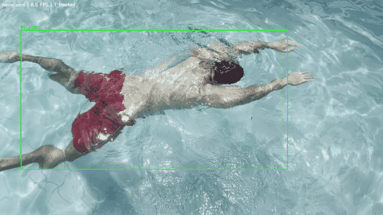
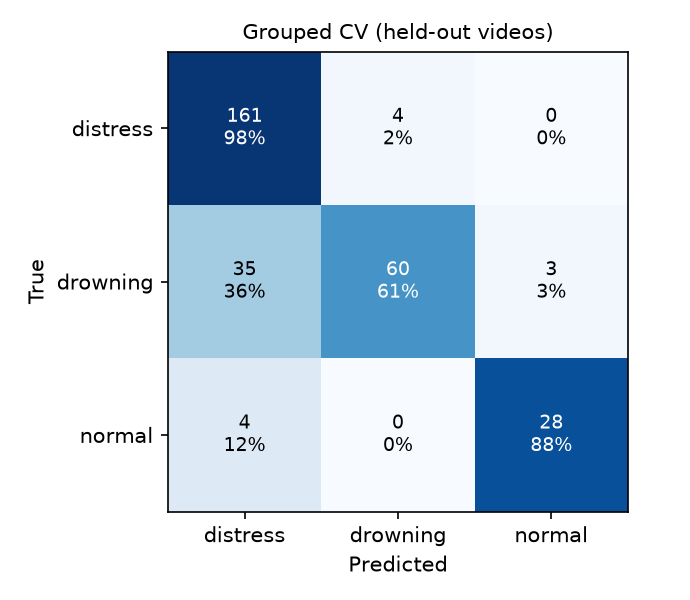

# AquaGuard — Real-Time Drowning Detection

AquaGuard watches pool video and alerts when a swimmer shows signs of distress or drowning. It tracks every person in frame, reads their body posture over a rolling 3-second window, and classifies each swimmer as **normal**, **distress** (upright, active struggle) or **drowning** (passive, motionless).

The feature set comes from four years of lifeguarding. Real drowning rarely looks like the splashing and shouting people expect. The instinctive drowning response is upright, silent and short, with arms pressing down at the surface and almost no kick. Each feature here encodes one of those cues.



## Architecture

```
video ─► YOLO26-pose + ByteTrack ─► plausibility filter ─► per-track 90-frame keypoint buffer
                                                                │
                              14 biomechanical features ◄───────┘
                                        │
                              FastAPI /predict (Random Forest)
                                        │
                     AlertPolicy (must hold 2–3 s, 30 s cooldown)
                                        │
                  FastAPI /incidents ─► SQLite log ─► Twilio SMS
                                        │
                              Streamlit dashboard
```

**Design decisions**

- **One model for detection, tracking and pose.** The project started as YOLOv8 + MediaPipe. It moved to YOLO26-pose because MediaPipe can't be fine-tuned on aquatic footage and YOLO-pose can. Every feature only used COCO-17 joints anyway, so MediaPipe's 33 keypoints added nothing.
- **Window-length-invariant features.** Every feature is a mean, ratio or per-second rate. The live pipeline can then predict from a partially filled buffer (63 of 90 frames) when detection drops out on choppy water, without shifting the feature distribution away from training.
- **Jitter-robust motion counting.** Stroke and bob frequencies count only reversals larger than 15% of the swimmer's torso length. Counting raw sign flips made a motionless swimmer look frantic, because pose jitter flips direction nearly every frame.
- **Confidence-gated leg features.** Submerged ankles produce noisy keypoints. Without gating, passive victims looked like the most active kickers.
- **Alerts require persistence.** One confident window never alerts. The danger label must hold for 2 s (drowning) or 3 s (distress), the way a lifeguard confirms a scan before committing.
- **Grouped evaluation.** Training windows overlap 83%, so a random split leaks near-duplicates across train and test. Cross-validation holds out whole videos.

## Results

Grouped 4-fold cross-validation on 295 windows from 19 videos. Every window is scored by a model that never saw its video.

| class | precision | recall | windows | videos |
|---|---|---|---|---|
| distress | 0.81 | 0.98 | 165 | 11 |
| drowning | 0.94 | 0.61 | 98 | 6 |
| normal | 0.90 | 0.88 | 32 | 4 |

**Accuracy:** 84%. **Danger vs normal:** 98.9% of danger windows flagged (260/263).

The main error is drowning windows predicted as distress (35 of 98). Both classes trigger an alert, so the alert policy scores danger as P(distress) + P(drowning) instead of trusting either label alone. Only 3 drowning windows were classified as normal.

The top features are wrists above shoulders, body angle and vertical posture. Those match the instinctive drowning response: upright, with arms pressing down at the surface.



## Setup

```bash
python -m venv venv && source venv/bin/activate
pip install -r requirements.txt
cp .env.example .env          # optional: Twilio creds; SMS runs in dry-run without them
```

## Run

```bash
# 1. Build the dataset from labeled clips (data/extracted_features/labels.csv)
python src/features/extract_dataset.py

# 2. Train + evaluate
python src/models/train_baseline.py

# 3. Serve, run, monitor (three terminals)
uvicorn src.api.main:app
python src/pipeline.py data/raw_videos/clip.mp4 --out demo.mp4
streamlit run src/dashboard/app.py

# Tests (no GPU or video needed)
pytest -q
```

## Project structure

```
src/
├── config.py                   # constants shared by extraction, training and live
├── detection/
│   ├── yolo_pose_estimator.py  # YOLO26-pose + ByteTrack, plausibility filter
│   └── bytetrack_pool.yaml
├── features/
│   ├── feature_engineer.py     # 14 biomechanical features
│   └── extract_dataset.py      # labeled clips -> windows (70% coverage gate)
├── models/
│   ├── train_baseline.py       # Random Forest + grouped CV + reports
│   └── finetune_detector.py    # aquatic detector fine-tuning (in progress)
├── api/
│   ├── main.py                 # FastAPI: /predict, /incidents, /health
│   └── db.py                   # SQLite incident log
├── alerts/
│   ├── policy.py               # sustain + cooldown alert logic
│   └── notifier.py             # Twilio SMS (dry-run without creds)
├── dashboard/app.py            # Streamlit monitor
└── pipeline.py                 # real-time loop
tests/                          # unit + end-to-end tests on synthetic swimmers
```

## Known limitations

- **Camera geometry.** Features are computed in the image plane and assume a roughly side-on view. Overhead footage inverts body angle, so it is excluded from training.
- **Detection on submerged swimmers.** COCO-trained detectors miss partially submerged people and hallucinate them in splashes. That causes track churn, which is mitigated by box plausibility filtering, a minimum track age, and tuned ByteTrack thresholds. The real fix is fine-tuning pose estimation on pool footage.
- **Dataset size.** The dataset is small (19 videos). Normal swimming has only 4 videos, so the false-alarm rate is the least reliable number here, and normal swimming is most of what a real pool looks like. This is a portfolio prototype, not a certified safety device.

## Roadmap

- [x] YOLO26-pose detection + ByteTrack tracking
- [x] Biomechanical feature engineering
- [x] Random Forest baseline with grouped CV
- [x] FastAPI model serving
- [x] Real-time pipeline with sustained-alert policy
- [x] SQLite incident logging + Twilio SMS
- [x] Streamlit dashboard

*Ethan Kim · MIT EECS '29*
